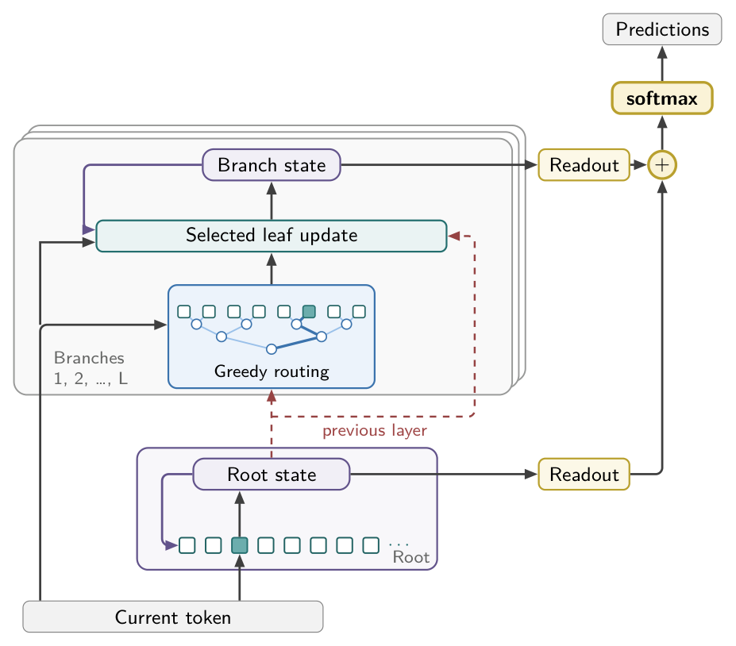
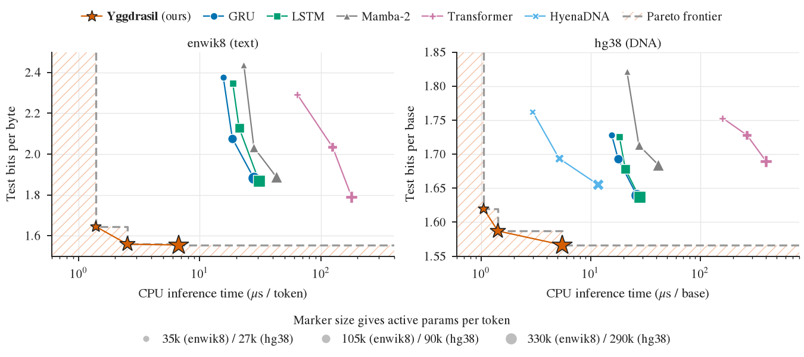

# Yggdrasil

Sequence models that run token by token on a CPU read every weight at every step, so their time per token grows with their size.

Yggdrasil stores 1,024 transitions per layer and reads **one per token**, selected by a depth-10 binary tree. A
195M-parameter model reads **0.2%** of its weights per token, trains as a parallel scan, and runs in an int8
CPU kernel.

- **1.555 bpc on enwik8** vs 1.719 for the best baseline at the same active parameters
- **1.567 bits/base on hg38** vs 1.637 for the best baseline, ahead of HyenaDNA
- **1.1 µs per base** on one CPU core, **15×** faster than GRU and **152×** faster than a Transformer
- **178× to 3,782×** faster than dense models with the same stored parameters (5M to 800M)
- **1.000 on all five state-tracking tasks**, including S5, where every other parallel model scores 0.000

## Results

Largest size, best of 3 seeds, single-core CPU inference.

| Model | enwik8 bpc | CPU µs / token | hg38 bits / base | CPU µs / base |
|---|---|---|---|---|
| **Yggdrasil** | **1.555** | **6.7** | **1.567** | **5.5** |
| GRU | 1.885 | 27.8 | 1.640 | 26.4 |
| LSTM | 1.869 | 30.8 | 1.637 | 27.9 |
| Mamba-2 | 1.888 | 42.8 | 1.685 | 41.4 |
| Transformer | 1.792 | 178.6 | 1.690 | 400.1 |
| Gated DeltaNet | 1.727 | – | 1.653 | – |
| DeltaProduct-2 | 1.719 | – | 1.694 | – |
| DeltaProduct-4 | 1.736 | – | 1.651 | – |
| HyenaDNA | – | – | 1.655 | 11.7 |

State tracking, sequence accuracy at the test length.

| Model | S5 | A5 | Parity | Cycle | Mod. arith. |
|---|---|---|---|---|---|
| **Yggdrasil** | **1.000** | **1.000** | **1.000** | **1.000** | **1.000** |
| GRU | 1.000 | 1.000 | 1.000 | 1.000 | 1.000 |
| LSTM | 1.000 | 1.000 | 1.000 | 1.000 | 1.000 |
| Transformer | 0.000 | 0.000 | 0.000 | 0.000 | 0.000 |
| Mamba-2 | 0.000 | 0.000 | 0.000 | 0.000 | 0.231 |
| Gated DeltaNet | 0.000 | 0.000 | 1.000 | 0.715 | 1.000 |
| DeltaProduct-2 | 0.000 | 0.334 | 1.000 | 0.129 | 1.000 |
| DeltaProduct-4 | 0.000 | 0.213 | 1.000 | 0.201 | 1.000 |

## Setup

    bash shared/setup_envs.sh                                # .venvs/{jax,torch,flashattn,infer}
    python -I shared/data/prepare_genomics.py --only hg38    # enwik8: unzip enwik8.zip into data/

## Train

    .venvs/jax/bin/python models/yggdrasil/training/train.py train --task enwik8 --n 256 --depth 10 --layers 5 --steps 80000
    .venvs/jax/bin/python models/yggdrasil/training/train.py train --task s5_word
    python shared/train.py --model gru --task enwik8         # any baseline: gru lstm mamba2 transformer
                                                             # gated_deltanet deltaproduct pdssm hyenadna

## CPU inference

    make -C models/yggdrasil/inference ygg
    .venvs/jax/bin/python models/yggdrasil/inference/export.py --npz results/<run>.npz --out model.bin
    .venvs/jax/bin/python models/yggdrasil/inference/check.py --npz results/<run>.npz --model model.bin

## License

MIT (see LICENSE). Third-party code under `models/*/training/third_party/` keeps its own license.
