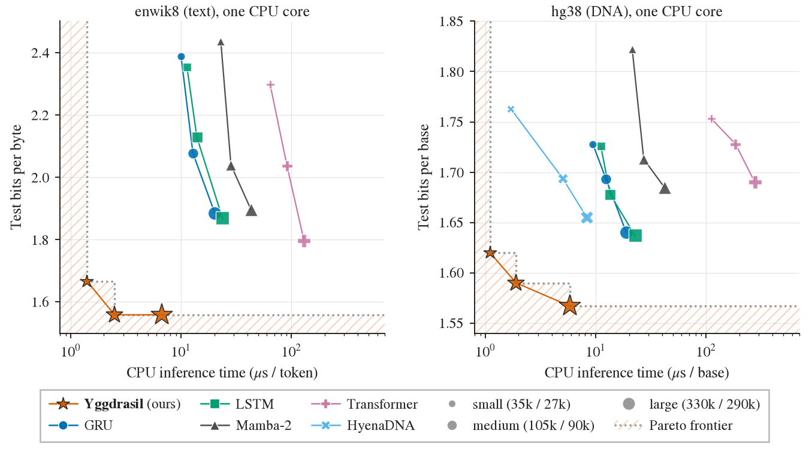

# Yggdrasil

**Sparse Lookup of State Transitions**

Yggdrasil is a recurrent sequence model that looks up its state transition instead of computing it.

Mixtures of experts and memory layers read only a few of their stored parameters per token, but only in the layers that
produce an output. The recurrence, where a model keeps its state, has stayed dense. Yggdrasil makes the recurrence itself
sparse. Each layer stores 2^D transitions, and a binary tree router picks one per token from the token and the state of
the layer below. Storage grows exponentially with the router depth D, while the work per token grows linearly. Training
is a parallel scan, and inference runs one token at a time in an int8 kernel on a single CPU core.

## Highlights

- **Lowest bits per token at every size** on enwik8 and the human genome: **1.540 bits per byte** and **1.567 bits per
  base** at 330k and 290k active parameters, against 1.724 and 1.637 for the best baselines.
- **Faster at batch 1:** 3.0× to 3.3× faster on one CPU core than the fastest baseline with a streaming step, and 1.2×
  to 4.0× faster than the Transformer, Gated DeltaNet and HyenaDNA on a GPU.
- **Solves all five state-tracking tasks**, the only parallel-trainable model to do so.
- **162× to 13,566× faster** on one CPU core than dense models with the same stored parameters, and at least 3,289×
  at 730M.
- **Exact state in theory:** tracks S5 and A5 exactly, also in 8-bit integers, and every finite automaton.
- **Trades memory for compute:** the largest enwik8 model is 681.3 MB, against at most 1.5 MB for the dense baselines.

<p align="center"></p>

## Results

<p align="center"></p>

**enwik8 at 330k active parameters.** Microseconds per token at batch 1 on one CPU core and on one GPU, and float test
bits per byte on the full test split, the seed with the best validation score. Bold marks the best per column.

| | Model | Total | Active | File (MB) | CPU µs/tok | GPU µs/tok | Test bits / byte (Hutter 2006) |
|---|---|---:|---:|---:|---:|---:|---|
| Sequential | GRU | 357.2k | 318.4k | 1.4 | 20.2 | 87.1 | 1.885 |
| | LSTM | 368.0k | 333.3k | 1.5 | 23.7 | 125.3 | 1.869 |
| Parallel | Transformer | 373.3k | 344.7k | 0.5 | 130.0 | 224.4 | 1.796 |
| | Mamba-2 | 335.8k | 303.2k | 1.2 | 43.0 | **43.8** | 1.896 |
| | Gated DeltaNet | 348.9k | 324.4k | – | – | 125.5 | 1.727 |
| | DeltaProduct-2 | 373.6k | 351.2k | – | – | 179.9 | 1.724 |
| | DeltaProduct-4 | 331.4k | 311.0k | – | – | 162.0 | 1.740 |
| | **Yggdrasil** | 195.4M | 329.5k | 681.3 | **6.7** | 80.1 | **1.540** |

**State tracking.** Final-answer accuracy on test lengths 40 to 256 after training on lengths 3 to 40: the seed with
the best validation score. Bold marks a solved task (accuracy ≥ 0.90).

| | Model | S5 (Merrill et al. 2024) | A5 (Merrill et al. 2024) | Parity (Delétang et al. 2023) | Cycle (Delétang et al. 2023) | Mod. arith. (Delétang et al. 2023) |
|---|---|---|---|---|---|---|
| Sequential | GRU | **0.979** | **1.000** | **1.000** | **1.000** | **1.000** |
| | LSTM | **0.995** | **0.999** | **1.000** | **1.000** | **1.000** |
| Parallel | Transformer | 0.010 | 0.031 | 0.506 | 0.238 | 0.225 |
| | Mamba-2 | 0.010 | 0.017 | 0.569 | 0.650 | 0.395 |
| | Gated DeltaNet | 0.018 | **0.999** | **0.999** | 0.615 | 0.826 |
| | DeltaProduct-2 | 0.688 | **0.999** | **1.000** | 0.713 | **1.000** |
| | DeltaProduct-4 | **0.935** | **1.000** | **1.000** | 0.684 | **1.000** |
| | Yggdrasil | **1.000** | **0.980** | **1.000** | **1.000** | **0.981** |

**Speed at equal stored parameters.** CPU time of Yggdrasil per token and its speedup over each dense model with the
same stored parameters, at batch 1. File / Q8_0 is the Yggdrasil file size over the Q8_0 file of the matched
Transformer.

enwik8, V = 256 (Hutter 2006)

| Stored params | Active | CPU µs | File / Q8_0 | vs Transformer | vs Mamba-2 | vs GRU | vs LSTM |
|---|---:|---:|---:|---:|---:|---:|---:|
| 5M | 56k | 1.02 | 0.98 | 518× | 473× | 174× | 162× |
| 20M | 123k | 3.15 | 1.07 | 493× | 451× | 166× | 163× |
| 50M | 102k | 3.76 | 1.16 | 1,178× | 1,480× | 511× | 512× |
| 200M | 103k | 5.45 | 1.16 | 3,311× | 3,895× | 1,805× | 1,812× |
| 730M | 172k | 11.06 | 1.17 | 5,146× | 6,214× | 3,300× | 3,289× |

hg38, V = 5 (Kelley et al. 2018; Nguyen et al. 2023)

| Stored params | Active | CPU µs | File / Q8_0 | vs Transformer | vs Mamba-2 | vs GRU | vs LSTM |
|---|---:|---:|---:|---:|---:|---:|---:|
| 5M | 62k | 0.96 | 0.86 | 1,740× | 421× | 173× | 165× |
| 20M | 98k | 2.14 | 0.88 | 2,177× | 555× | 219× | 217× |
| 50M | 81k | 2.25 | 0.87 | 5,332× | 2,219× | 811× | 816× |
| 200M | 83k | 3.48 | 0.87 | 9,375× | 5,780× | 2,823× | 2,831× |
| 730M | 139k | 7.72 | 0.86 | 13,566× | 9,131× | 4,683× | 4,721× |

## Install

```sh
pip install -e ".[jax,dev]"   # training, inference and tests (on a GPU machine, jax[cuda12]==0.11.2)
pip install torch==2.10.0 --index-url https://download.pytorch.org/whl/cu128   # before [gpu] and [baselines]
pip install -e ".[gpu]"       # Triton GPU inference backend
pip install --no-build-isolation -e ".[baselines]"   # baseline models
pip install -e ".[sweep]"     # W&B sweeps
python -m tasks.prepare enwik8 hg38
```

The data lives in `$YGGDRASIL_DATA` (default `data/`). `[flash]` reproduces the Transformer with FlashAttention-2 in
a separate torch 2.8 environment.

## Checkpoints

The 11 reported Yggdrasil models, each as `<id>.npz` (weights) and `<id>.json` (run record), with `SHA256SUMS`, at
`https://github.com/CosmoNaught/yggdrasil/releases/download/v1.0.0`.

```sh
export YGG_RUNS=results   # one id; list more inside the braces
curl -fL --create-dirs -o "$YGG_RUNS/#1" "https://github.com/CosmoNaught/yggdrasil/releases/download/v1.0.0/{enwik8_small.npz,enwik8_small.json,SHA256SUMS}"
```

| id | Size (MB) | Paper |
|---|---:|---|
| `enwik8_small` | 65.1 | enwik8, small (CPU Pareto figure) |
| `enwik8_medium` | 216.9 | enwik8, medium (CPU Pareto figure) |
| `enwik8_large` | 781.8 | enwik8 at 330k active parameters, large (CPU Pareto figure) |
| `hg38_small` | 62.2 | hg38, small (CPU Pareto figure) |
| `hg38_medium` | 208.1 | hg38, medium (CPU Pareto figure) |
| `hg38_large` | 751.9 | hg38 at 290k active parameters, large (CPU Pareto figure) |
| `s5_word` | 7.5 | State tracking, S5 |
| `a5_word` | 13.1 | State tracking, A5 |
| `parity_check` | 0.5 | State tracking, parity |
| `cycle_navigation` | 1.0 | State tracking, cycle navigation |
| `modular_arithmetic` | 3.6 | State tracking, modular arithmetic |

## Quick start

```python
import numpy as np
from yggdrasil import Yggdrasil

model = Yggdrasil.load("results/enwik8_small.npz")  # backend="triton" for the GPU step
tokens = np.frombuffer(b"The tree of life", np.uint8)[None]
logits, state = model.step(tokens[:, 0], model.init_state(1))
bits = model.score(tokens)                           # bits of tokens[:, 1:] per row
out = model.generate(tokens[0], 256, temperature=0.8, top_k=40)
```

CPU kernel (AVX-512 VNNI), see `cpu/README.md`. The export reads the run record `<id>.json` next to the checkpoint.

```sh
make -C cpu ygg
python cpu/export.py --npz results/enwik8_small.npz --out model.bin
python cpu/check.py --npz results/enwik8_small.npz --model model.bin
```

## Reproduce

`python -m yggdrasil.train --config <config> --seed <s>` trains one Yggdrasil seed and writes the best validation
checkpoint and its test score to `results/`. Seeds are 0, 1, 2 on text and DNA and 160, 161, 162 on the state tasks.
`python -m yggdrasil.sweep --config <config>` creates the W&B sweep of a config; run it with `wandb agent <id>`. Every
released checkpoint runs on `Yggdrasil.load` (JAX) and `backend="triton"` (GPU), and the six enwik8 and hg38 models
also on the int8 CPU kernel.

For the baselines the repository holds the model code and the selected settings of every reported cell
(`baselines/configs`), plus the search protocol (`sweeps/README.md`).

| Paper | Yggdrasil config | Baseline settings |
|---|---|---|
| enwik8 at 330k active parameters | `configs/enwik8/large.yaml` | `baselines/configs/enwik8/large/<model>.yaml` |
| CPU Pareto figure | `configs/{enwik8,hg38}/{small,medium,large}.yaml` | `baselines/configs/{enwik8,hg38}/<size>/<model>.yaml` |
| State tracking | `configs/state/<task>.yaml` | `baselines/configs/state/<task>/<model>.yaml` |
| Ablations | `configs/ablation/{store_outputs,token_routing}.yaml` | – |

`pytest` (with `make -C cpu ygg` for the kernel tests) checks a checkout against the reported models, reading the
checkpoints from `$YGG_RUNS`.

## Citation

```bibtex
@article{santoni2026yggdrasil,
  title   = {Yggdrasil: Sparse Lookup of State Transitions},
  author  = {Santoni, Cosmo},
  journal = {arXiv preprint},
  year    = {2026}
}
```

## Licence

MIT, see `LICENSE`. Code under `baselines/third_party/` keeps its own licence.
